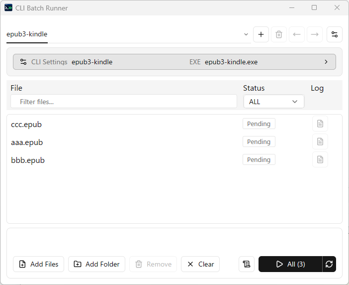
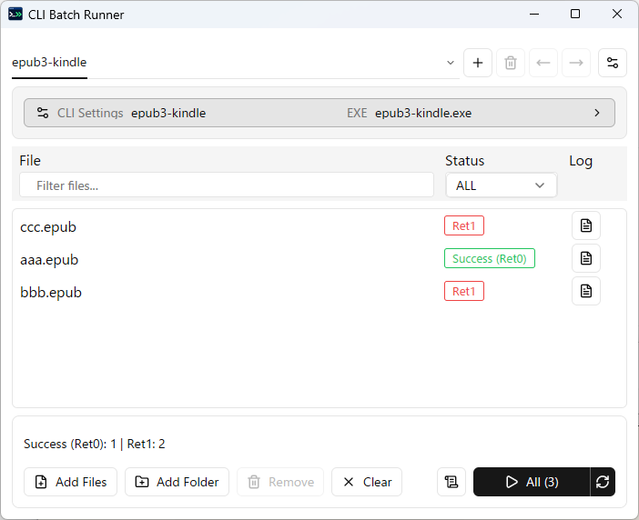

# CLI Batch Runner

A Windows desktop app for running a CLI tool over a queue of files. Save tools as tabs, add files, and follow each run through its progress and logs.

## Features

1. **CLI Tool Management** — Manage multiple CLI tools in tabs.
2. **File Registration** — Add files or folders, with drag-and-drop support.
3. **Batch Execution** — Run visible or selected files sequentially, see the target count, and stop a batch.
4. **Log Management** — View, copy, and export per-file and batch logs, with optional run history.

## Download

Download the latest version from the [Releases page](https://github.com/cbz-tools/cli-batch-runner/releases).

| Platform | Release package | Application |
|---|---|---|
| Windows x64 | `cli-batch-runner-vx.x.x-windows-x64.zip` | `cli-batch-runner.exe` |

Extract the ZIP and launch `cli-batch-runner.exe`.

## Screenshots

<table>
  <tr><th>Ready to Run</th><th>Completed</th></tr>
  <tr>
    <td><a href="docs/screenshots/ready-to-run.png"></a></td>
    <td><a href="docs/screenshots/completed.png"></a></td>
  </tr>
</table>

## Quick Start

1. **Configure** — Open **CLI Settings**, select a CLI executable, configure its arguments, and click **Save**.
2. **Add Files** — Use **Add Files**, **Add Folder**, or drag and drop to add files to the queue.
3. **Run** — Click the **Start** button to run the queued files.

For detailed instructions, see the [User Guide](docs/USER_GUIDE.md).

## Usage / Examples

CLI Batch Runner launches CLI executables directly. The following placeholders can be used in argument templates.

### Placeholders

For an input file at `C:\Files\Sample.txt`:

| Placeholder | Expansion |
|---|---|
| `{input}` | `C:\Files\Sample.txt` |
| `{input_dir}` | `C:\Files` |
| `{input_name}` | `Sample.txt` |
| `{input_stem}` | `Sample` |
| `{input_ext}` | `txt` |

### SHA256 Hash — Windows Built-in CLI

Executable:

```text
C:\Windows\System32\certutil.exe
```

Arguments:

```text
-hashfile {input} SHA256
```

Calculates the SHA256 hash of the input file. View the result in File Log.

### Base64 Export — Windows Built-in CLI

Executable:

```text
C:\Windows\System32\certutil.exe
```

Arguments:

```text
-encode "{input_dir}\{input_name}" "{input_dir}\{input_stem}.{input_ext}.base64.txt"
```

Exports the input file as Base64-encoded text.

### External Tool Example — Epub3-Kindle

[Epub3-Kindle](https://github.com/cbz-tools/Epub3-Kindle) is an optional EPUB converter installed separately. It is not bundled with CLI Batch Runner.

Executable:

```text
C:\Tools\Epub3-Kindle\epub3-kindle.exe
```

| Purpose | Arguments |
|---|---|
| EPUB to MOBI | `{input}` |
| EPUB to AZW3 | `{input} -o "{input_dir}\{input_stem}.azw3"` |

## Build from Source

Requirements:

- Windows x64
- Rust stable (`x86_64-pc-windows-msvc`)
- Visual Studio or Build Tools with **Desktop development with C++**
- Windows 10/11 SDK (`mt.exe`)

Build and verify:

```powershell
.\scripts\build-release.ps1
.\scripts\verify-release.ps1
```

## Documentation

- [User Guide](docs/USER_GUIDE.md)
- [Third-party License Notices](THIRDPARTY_LICENSES.md)

## Changelog

See [CHANGELOG.md](CHANGELOG.md).

## License

MIT — see [LICENSE](LICENSE).

Third-party licenses and notices are listed in [THIRDPARTY_LICENSES.md](THIRDPARTY_LICENSES.md).
